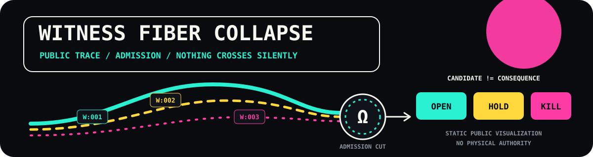

<p align="center">
  
</p>

# KY-ROX Public Demonstrators — Runnable Gates & FPGA Prototypes

[](https://doi.org/10.5281/zenodo.24032490)
[](https://orcid.org/0009-0006-0431-6637)
[](LICENSE)

> **Coordinate (`4 · Gate`):** [`(0,0) sololys`](https://github.com/sololys) — [`1 · Word`](https://github.com/sololys/skrivevaerelset) → [`2 · Draft`](https://github.com/sololys/epistemic-architectures-notes) → [`3 · Rule`](https://github.com/sololys/epistemic-architectures) → **`[4 · Gate]`** → [`5 · Seal`](https://github.com/sololys/monolitt)

Runnable Python microtests (Python 3.10+ Standard Library only) and synthesizable SystemVerilog (`IEEE 1800-2012`) gate prototypes implementing the specifications in [`epistemic-architectures`](https://github.com/sololys/epistemic-architectures).

$$\Omega(x, e, r_{\mathrm{hold}}, \tau) = \begin{cases} \mathrm{KILL\_GATE\_CAPTURE}\;(0.00\text{ V}) & \text{if } \Omega_1 \neq \Omega_2 \;\text{(sticky)} \\ \mathrm{KILL}\;(0.00\text{ V}) & \text{if } \Omega_1 = \Omega_2 \land \Delta_K(x) > \tau_K \\ \mathrm{OPEN}\;(5.00\text{ V}) & \text{if } \Omega_1 = \Omega_2 \land \Delta_K(x) \le \tau_K \land e \neq \varnothing \land \mathrm{Zone}(x) = \mathrm{CLEAR} \\ \mathrm{HOLD}\;(0.00\text{ V}, \mathrm{P}_{\mathrm{INT}}) & \text{if } \Omega_1 = \Omega_2 \land \Delta_K(x) \le \tau_K \land (e = \varnothing \lor \mathrm{Zone}(x) = \mathrm{OCCUPIED}) \land r_{\mathrm{hold}} \neq \varnothing \land \tau \le \tau_{\max} \\ \mathrm{HOLD}\;(0.00\text{ V}, \mathrm{P}_{\mathrm{EXT}}, e_{\mathrm{pend}} \leftarrow \varnothing) & \text{if } \Omega_1 = \Omega_2 \land \Delta_K(x) \le \tau_K \land (e = \varnothing \lor \mathrm{Zone}(x) = \mathrm{OCCUPIED}) \land (r_{\mathrm{hold}} = \varnothing \lor \tau > \tau_{\max}) \end{cases}$$

* **Author:** Marius Egerhei Torjusen · Risør, Norway ([ORCID `0009-0006-0431-6637`](https://orcid.org/0009-0006-0431-6637) · Zenodo DOIs [`10.5281/zenodo.18436983`](https://doi.org/10.5281/zenodo.18436983) · [`10.5281/zenodo.22229111`](https://doi.org/10.5281/zenodo.22229111))
* **Epistemic Boundary (`INSPIRED_BY != IMPLEMENTS != PROVES`):** Bounded `L1` software microtests (`60/60 PASS` across 10 suites — 7 microtests, 2 monolith gates, and `KY v1.5` — plus `10/10 PASS` in `L1_LAW/invariants_pure.py`) and `L1`/`L1.5` C11/QNX/RTL testbenches (`0.00 V DC`, zero physical or operational authority).

---

## I. Run & Verify (`Makefile` & `run_demo.py`)

```bash
# Default invocation fails closed by design (HOLD = 0.00 V DC):
make
# -> [HOLD] 0.00 V DC. System is at rest. (exit code 1)

# Full deterministic verification of L1_LAW (10/10), L2_GATE, 7 microtests, and 10 Suites (60/60 PASS):
make verify
# Or directly:
python3 run_demo.py

# Optional C11, QNX 8.0, and SystemVerilog RTL verification:
make sim_vektor_a # 133,425 ps (20.0 m) Vektor A light-cone airlock + SPEC-411 galvanic sluice (C11 + iverilog)
make qnx_vektor_a # Dual-arch QNX 8.0 Vektor A + SPEC-411 safety cage (qcc x86_64 + aarch64le, 0 float)
make sim_k_sluice    # 128-bit K-Filter single-arm sluice (C11 + iCE40UP5K RTL, 12/12 XOR == 0, 14.87 MHz post-PnR)
make sim_bell_ky     # 7-qubit Bell-KY CPTP & 128-bit CHSH sluice (C11 + iCE40UP5K RTL, 22/22 XOR == 0, 21.34 MHz post-PnR)
make sim_omni_crash3 # Conjunctive L_inf Crash_3 & Z[phi] sluice (C11 + iCE40UP5K RTL, 22/22 XOR == 0, 26.86 MHz post-PnR)
make sim_nlk_enigma  # KY-Enigma v1.1 -> NLK Coordinate Board & LIFO sluice (C11 + iCE40UP5K RTL, 24/24 XOR == 0, 23.36 MHz post-PnR)
make sim_205b     # 205-byte capsule frame decoder & 12.5 us guillotine testbench (iverilog)
make sim_400c     # 400-cycle temporal bifurcation gate testbench (iverilog)
make sim_omega64  # Zero-float C11 64-byte SPI HAL pack + SystemVerilog symplectic watchdog
make qnx_omega64  # Dual-arch QNX 8.0 build (qcc x86_64 + aarch64le, 0 float, -Werror)
```

---

## II. Directory Map

| Directory | Role | Primary Artifacts |
| :--- | :--- | :--- |
| **[`L1_LAW/`](L1_LAW/)** | Pure mathematical definitions (`KY_ROX_SCOPE_GATE_V0_2`), KY codec & public boundary contracts. Zero I/O. | [`invariants_pure.py`](L1_LAW/invariants_pure.py) (`10/10 PASS`) · [`ky_v15_clean_parser.py`](L1_LAW/ky_v15_clean_parser.py) (`6/6 PASS`, `0 float`) · [`KY_SPEC_v1.5.md`](L1_LAW/KY_SPEC_v1.5.md) · [`ky_parser.py`](L1_LAW/ky_parser.py) · [`PUBLIC_BOUNDARY.md`](L1_LAW/PUBLIC_BOUNDARY.md) · [`STATUS_PUBLIC.md`](L1_LAW/STATUS_PUBLIC.md) · [`SECURITY.md`](L1_LAW/SECURITY.md) |
| **[`L2_GATE/`](L2_GATE/)** | Consequence gate evaluators ($\Omega \circ \Pi_K$), `133,425 ps` Vektor A light-cone airlock, `SPEC-411` galvanic sluice, C11/QNX 64B SPI HAL, & SystemVerilog RTL gate modules. | [`vektor_a_airlock.sv`](L2_GATE/vektor_a_airlock.sv) · [`vektor_a_gate.h`](L2_GATE/vektor_a_gate.h) · [`spec411_galvanic_gate.sv`](L2_GATE/spec411_galvanic_gate.sv) · [`spec411_gate.h`](L2_GATE/spec411_gate.h) · [`vektor_a_spec411_sluice_top.sv`](L2_GATE/vektor_a_spec411_sluice_top.sv) · [`vektor_a_qnx_resmgr.c`](L2_GATE/vektor_a_qnx_resmgr.c) · [`evaluate_boundaries.py`](L2_GATE/evaluate_boundaries.py) · [`omega_hal_pack.c`](L2_GATE/omega_hal_pack.c) · [`omega_qnx_resmgr.c`](L2_GATE/omega_qnx_resmgr.c) · [`omega_symplectic_watchdog_64b.sv`](L2_GATE/omega_symplectic_watchdog_64b.sv) · [`fpga_capsule_frame_205b_decoder.sv`](L2_GATE/fpga_capsule_frame_205b_decoder.sv) · [`kpod_fpga_guillotine_12u5.sv`](L2_GATE/kpod_fpga_guillotine_12u5.sv) · [`temporal_bifurcation_400c.sv`](L2_GATE/temporal_bifurcation_400c.sv) · [`gothenburg_corridor_rosetta_top.sv`](L2_GATE/gothenburg_corridor_rosetta_top.sv) |
| **[`L3_WITNESS/`](L3_WITNESS/)** | Append-only SHA-256 hash-chain log ($W^2$). | [`audit_log.jsonl`](L3_WITNESS/audit_log.jsonl) *(software hash chain, not physical WORM)* |
| **[`artifacts/microtests/`](artifacts/microtests/) & [`monoliths/`](monoliths/)** | Seven Microtest Suites (`7 x 6/6` + `CHECKSUMS.sha256`), Two Horizon/Domain Monoliths (`SPEC-412..415`), & `KY v1.5` (`10 x 6/6 = 60/60 PASS`). | See Section III below |
| **[`punkt/contracts/`](punkt/contracts/)** | Claim-level & decision vocabulary contracts (`INSPIRED_BY != IMPLEMENTS != PROVES`). | [`claim-levels.md`](punkt/contracts/claim-levels.md) · [`candidate-not-consequence.md`](punkt/contracts/candidate-not-consequence.md) · [`decision-vocabulary.md`](punkt/contracts/decision-vocabulary.md) |
| **[`demos/granite-sg48-etor-cascade/`](demos/granite-sg48-etor-cascade/)** | Interactive 3D WebGL demonstrator for the `iCE40UP5K-SG48` E-TOR Cascade (`4 648/5 280 LC`, `26.22 MHz` STA, 242B UART map, `L1.5` model). | [`App.tsx`](demos/granite-sg48-etor-cascade/src/App.tsx) · [`etorProtocol.ts`](demos/granite-sg48-etor-cascade/src/sim/etorProtocol.ts) · [`GraniteViewport.tsx`](demos/granite-sg48-etor-cascade/src/scene/GraniteViewport.tsx) |

### II.B `133,425 ps` Causal Light-Cone Airlock & `SPEC-411` Galvanic Sluice (`L1` / `L1.5`)

For local-first critical infrastructure interlocks (`Infranett` / `KY-ROX`), [`L2_GATE/`](L2_GATE/) pairs exact integer C11, QNX Neutrino 8.0 (`_NTO_CHF_FIXED_PRIORITY | _NTO_CHF_DISCONNECT`), and synthesizable `IEEE 1800-2012` SystemVerilog (`Lattice iCE40UP5K-SG48`):

- **Vektor A (`133,425 ps` Alexandrov Diamond):** Binds local actuation wake (`core_wake_en`) to round-trip speed-of-light Time-of-Flight over $R_{\max} = 20.0\text{ m}$ ($\tau_{\max} = \lfloor 40.0\text{ m} / c \rfloor = 133{,}425\text{ ps}$ at $c = 299{,}792{,}458\text{ m/s}$, rejecting $+1\text{ ps}$ at $133{,}426\text{ ps}$ and $500\text{ m}$ relays at $3{,}335{,}640\text{ ps}$ into `CAUSAL_HOLD` at `0.00 V DC`), locked to a $\pm 5.0\text{ ppm}$ crystal window ($200{,}000 \pm 1\text{ tick}$) and a one-way optical telemetry diode (`optical_tx_only`).
- **`SPEC-411` Dual-Rail Galvanic Separation ($\partial \Omega_Y / \partial \Omega_T \equiv 0$):** Hardwires the unconditional Fail-Open existence rail ($\Omega_Y = 5.00\text{ V}$, `0x01`) independently of the Fail-Closed actuation rail ($\Omega_T \in \{0.00\text{ V}, 5.00\text{ V}\}$, `0x02`), with exact integer cross-multiplied divergence gating ($\Delta_K < \varepsilon$), Butterfly Pocket $A_5$ stasis (`0x08`), and non-erasing Level 01 reset recovery (`make sim_vektor_a`: `10/10` C11 + `17/17` RTL vectors, `XOR == 0`).
- **Dual-Track `K`-Filter Sluice (`SPEC-515 v1.1`):** Pairs exact rational Pythagorean $(3, 4, 5) \to (7, 24, 25)$ 2-qubit non-Markovian environment re-coupling ($\Delta p = 576/625$ vs. Markovian $\Delta p = 0$, [`test_k_filter_sluice_dual_track.py`](L2_GATE/test_k_filter_sluice_dual_track.py)) with [`k_filter_sluice.h`](L2_GATE/k_filter_sluice.h) and [`k_filter_sluice.sv`](L2_GATE/k_filter_sluice.sv) (`make sim_k_sluice`: `12/12` C11 $\leftrightarrow$ RTL vectors, `2,595 / 5,280 ICESTORM_LC` = `49%`, `0 DSP`, `67.25 ns` = `14.87 MHz` post-PnR `icetime` STA on `UPduino v3.1`).
- **7-Qubit Bell–KY CPTP & `128`-Bit CHSH Sluice (`29.KY`):** Replaces nonlinear trace division with an exact 128-dimensional rational Kraus channel ($\sum_\alpha K_\alpha^\dagger K_\alpha = I_{128}$, [`test_bell_ky_7qubit_cptp.py`](L2_GATE/test_bell_ky_7qubit_cptp.py)), pairs a 2-qubit Frobenius `L1 != L3` bluff scraper ($\|\Delta\rho_{AB}\|_F^2 = w^2/50$) with SI-2019 integer light-cone gating, and locks `22/22` `XOR == 0` boundary parity across [`bell_ky_sluice.h`](L2_GATE/bell_ky_sluice.h) and [`bell_ky_sluice.sv`](L2_GATE/bell_ky_sluice.sv) (`make sim_bell_ky`: `4,894 / 5,280 ICESTORM_LC` = `92%`, `0 DSP`, `46` logic levels, `46.87 ns` = `21.34 MHz` post-PnR `icetime` STA on `UPduino v3.1`).
- **Conjunctive $L_\infty$ Three-Way Collision Sluice (`25.OMNI` `Crash_3`):** Eliminates IEEE-754 `NaN` bypasses, disconnected $\dot{R} > \delta_R$ slopes, and tautological `(s^r)^r == s` masks via exact quadratic golden-ratio ring arithmetic $\mathbb{Z}[\varphi]$ ($2H_\varphi = A_H + B_H\varphi$, [`test_omni_crash3_linf.py`](L2_GATE/test_omni_crash3_linf.py)) and constant-time (`194`-cycle) C11/RTL hardware gating in [`omni_crash3_sluice.h`](L2_GATE/omni_crash3_sluice.h) and [`omni_crash3_sluice.sv`](L2_GATE/omni_crash3_sluice.sv) (`make sim_omni_crash3`: `22/22` `XOR == 0`, `3,649 / 5,280 ICESTORM_LC` = `69%`, `0 DSP`, `37.22 ns` = `26.86 MHz` post-PnR `icetime` STA on `UPduino v3.1`).
- **KY-Enigma v1.1 $\to$ NLK Spatial Coordinate Board & Reversible LIFO Sluice:** Pairs a stateless Layer-1 mod-26 conjugated involution proposer ($E_q(E_q(x)) = x,\ E_q(x) \neq x$) with a two-beat LUT4 hardware verifier, constant-time (`130`-cycle) 8-slot spatial Coordinate Board gauge $(q_0, \dots, q_K)$, three-rotor notch-cascade LIFO phase rewind, and SI-2019 `277 K` Landauer accounting (`2,652,306 rJ/bit`) in [`nlk_enigma_sluice.h`](L2_GATE/nlk_enigma_sluice.h), [`nlk_enigma_sluice.sv`](L2_GATE/nlk_enigma_sluice.sv), and [`test_nlk_enigma_board_sluice.py`](L2_GATE/test_nlk_enigma_board_sluice.py) (`make sim_nlk_enigma`: `24/24` `XOR == 0`, `3,348 / 5,280 ICESTORM_LC` = `63%`, `0 DSP`, `17` logic levels, `42.81 ns` = `23.36 MHz` post-PnR `icetime` STA on `UPduino v3.1`).

---

## III. Ten Public Demonstrator Suites (`10 x 6/6 = 60/60 PASS`)

Every demonstrator in [`artifacts/microtests/`](artifacts/microtests/) and [`monoliths/`](monoliths/) enforces deterministic execution, unit tests (`6/6 PASS` per suite), and cryptographic integrity:

| Monolith / Gate | Domain & Operator | Mathematical Invariant / Law | Verification |
| :--- | :--- | :--- | :--- |
| **1. [LightBridge v0.1](artifacts/microtests/light_bridge_consequence_gate_v0_1/SURFACE.md)** | Consequence Gate ($\Omega_{\text{bridge}}$) | No silent `HOLD` ($\Delta_K \neq \varnothing$); $\frac{d}{dt}\text{HOLD} = 0$, while $\Delta\tau > \tau_{\max}$ forfeits $\mathcal{P}_{\text{int}} \to \mathcal{P}_{\text{ext}}$ at `0.00 V`. Realization requires $e \neq \varnothing \land \text{Zone} = \text{CLEAR}$. $\Omega_1 \neq \Omega_2 \implies \text{KILL\_GATE\_CAPTURE}$; `reset()` is append-only on $\mathcal{L}$. | [`light_bridge.gd`](artifacts/microtests/light_bridge_consequence_gate_v0_1/light_bridge.gd) · [`light_bridge_gate.py`](artifacts/microtests/light_bridge_consequence_gate_v0_1/light_bridge_gate.py) (**`6/6 PASS`**) |
| **2. [ISAC Phase-Cone v0.1](artifacts/microtests/euclidean_phase_cone_isac_v0_1/SURFACE.md)** | Euclidean Wavefront ($\Pi_{S^1}$) | For $d = \lambda / 2$: $\sin\theta = \Delta\phi / \pi$. Physical wave: $\|\Delta\phi / \pi\| \le 1 \implies \cos\theta \in \mathbb{R} \implies \text{OPEN}$. Synthetic injection: $\|\Delta\phi / \pi\| > 1 \implies \cos\theta \in i\mathbb{R}_{>0} \implies \text{KILL}$. | [`euclidean_phase_cone.py`](artifacts/microtests/euclidean_phase_cone_isac_v0_1/euclidean_phase_cone.py) (**`6/6 PASS`**) |
| **3. [PUNKT // BANE Yin–Yang v0.1](artifacts/microtests/p_np_yinyang_binpacking_v0_1/SURFACE.md)** | Construction Path ($\gamma_P$ vs. $C_{NP}$) | Separates a static certificate point $C \in \mathcal{NP}$ from a sequentially verified construction path $\gamma = (x_0 \to x_n)$ bound by $W_{\text{PRE}}$ and $W_{\text{POST}}$. Status: `p_equals_np_claim_status = HOLD`. | [`yinyang_binpacking.py`](artifacts/microtests/p_np_yinyang_binpacking_v0_1/yinyang_binpacking.py) (**`6/6 PASS`**) |
| **4. [Kernel Drift Observable v0.1](artifacts/microtests/kernel_drift_observable_v0_1/SURFACE.md)** | Relational Geometry ($G_{ij} = \langle \psi_i, \psi_j \rangle$) | Pointwise norm $\|x_t - x_0\|$ is blind to rigid rotations and internal phase shear. Relational drift is measured over the Gram matrix $\Delta_G = \|G(t) - G(0)\|_F$. | [`kernel_drift.py`](artifacts/microtests/kernel_drift_observable_v0_1/kernel_drift.py) (**`6/6 PASS`**) |
| **5. [M-Polynomial & 1-WL Molecular Gate v0.1](artifacts/microtests/mpolynomial_1wl_molecular_gate_v0_1/SURFACE.md)** | Algebraic Graph Gate ($M(G; x, y)$ & $\Pi_K$) | $M(G; x, y) = \sum_{i \le j} m_{ij}x^i y^j$. Soft GNN concatenation ($h_v^{(0)} \parallel M_1 \parallel R \parallel H$) cannot resolve 1-WL co-polynomial collisions (Decalin vs. Bicyclopentyl $\to \text{HOLD}$) or block organic Texas Carbon ($\text{KILL}$), while admitting bio-inorganic `[Fe7MoS9C]` $\mu_6\text{-C}$ ($\text{OPEN}$). | [`mpolynomial_1wl_molecular_gate.py`](artifacts/microtests/mpolynomial_1wl_molecular_gate_v0_1/mpolynomial_1wl_molecular_gate.py) (**`6/6 PASS`**) |
| **6. [PWR2 Scrambling vs. Collective Gate v0.1](artifacts/microtests/pwr2_scrambling_collective_gate_v0_1/SURFACE.md)** | Spectral Spin-Graph Gate ($\Gamma_q^2(K)$ & $k^* \sim \sqrt{N}$) | $\Gamma_q^2(K) = \lambda_K(\lambda_q - \lambda_K)$. At staggered Néel mode $K = N/2$, only `PWR2` has $\lambda_{N/2} > 0$ ($\text{KILL}$ for $k > \sqrt{N}$), while symmetric collective states ($k = 0, \Delta > 0$) pass as $\text{OPEN}$. | [`pwr2_scrambling_collective_gate.py`](artifacts/microtests/pwr2_scrambling_collective_gate_v0_1/pwr2_scrambling_collective_gate.py) (**`6/6 PASS`**) |
| **7. [Horisont I: Staggered-PRF Fine–Wilf Gate v0.1](monoliths/staggered_prf_fine_wilf_gate.py)** | Combinatorial SDR Horizon ($L^* = p + q - \gcd(p,q)$) | Rejects dual-periodic Sturmian multipath ghost collisions at $L^* = 12$ ($p=5, q=8$), enforces array Bragg coherence $R \ge 0.95$, and integrates continuous Doppler range-rate $\int v_r\,\mathrm{d}t$. | [`staggered_prf_fine_wilf_gate.py`](monoliths/staggered_prf_fine_wilf_gate.py) (**`6/6 PASS`**) |
| **8. [Horisont II: Domain Gates `SPEC-412..415` v2.0](monoliths/spec412_415_domain_gates.py)** | Forlik (`SPEC-412`), Orbital (`SPEC-413`), Radar (`SPEC-414`), Benthic K-POD (`SPEC-415`) | 72h cooling-off & UWB proximity ($40/c \pm 4.5\text{ ns}$); sub-half-wavelength $\lvert s_{\text{obs}}\rvert \le 1$ & $K_p < 7.0$ stasis; 16-pt Radix-4 FFT, 5:6 CRT unfolding & Thom $A_5$ pocket ($c_{\text{war}} = +0.5525$); $-240\text{ m}$ 5 CDC locks, $^{57}\text{Fe}$ Mössbauer & Doppler-to-ToF courier bridge. | [`spec412_415_domain_gates.py`](monoliths/spec412_415_domain_gates.py) (**`6/6 PASS`**) |
| **9. [Sosionomos XOR/ROX Gate v0.1](artifacts/microtests/sosionomos_xor_rox_gate_v0_1/SURFACE.md)** | Social Realization Gate (`0 float`, `XOR`/`ROX`) | `StateCandidate (0x01) ^ RealizedConsequence (0x02) == 1`; double-pulse `XOR` involution (`MASK_MUTATED => KILL`), non-involutive `ROX` seal at `OPEN`, integer LUT Amygdala `HOLD`, `O(1)` backpressure `TRAP` to `ShadowDAG`, and `HOT/WARM/COLD` anchor survival. Spec: [`OMNI-KY & Sosionomos`](https://github.com/sololys/epistemic-architectures/blob/main/L1_LAW/OMNI_KY_SUSY2_SOSIONOMOS_BRIDGE_SPEC_v1.0.md). | [`sosionomos_xor_rox_gate.py`](artifacts/microtests/sosionomos_xor_rox_gate_v0_1/sosionomos_xor_rox_gate.py) (**`6/6 PASS`**) |
| **10. [KY Realization Grammar v1.5](L1_LAW/KY_SPEC_v1.5.md)** | Clean Causal Parser (`0 float`, `Option A`) | Enforces $\Sigma_{\text{state}}(\bullet) \cap \Sigma_{\text{suffix}}(!) = \varnothing$, strict $D_0 \to D_3$ transition order, `CONSEQUENCE_UNCERTAIN` tether (`BLIND_RETRY` forbidden), and Registry A rejection of bare Unicode or unanchored hash chains. | [`ky_v15_clean_parser.py`](L1_LAW/ky_v15_clean_parser.py) · [`test_ky_v15_clean_parser.py`](L1_LAW/test_ky_v15_clean_parser.py) (**`6/6 PASS`**) |

---

## IV. Claim & Authority Boundary (KY v1.5-MASTER & GKO Lab Note Seksjon 5)

```text
PUBLIC_TREE_GATE             = PASS
MICROTEST_GATE               = PASS (10 suites / 60 unit tests; 7 microtest dirs + L1_LAW + L2_GATE)
SCOPE                        = EXACT_CHECKED_TREE_ONLY
CLAIM_STATUS                 = HOLD (INSPIRED_BY != IMPLEMENTS != PROVES)
SIMULATION_CLASSIFICATION    = OPEN_AS_SOFTWARE_DEMONSTRATION (0xABCDEF00 — deterministisk demonstrert i simuleringsmotoren)
HARDWARE_D_LATCH_ACTUATION   = HOLD (Registry B: Ikke fysisk målt silisium-spenning; avventer GPIO/FPGA HIL-logg)
STANDALONE_HASH_OR_UNICODE   = KILL (Registry A: D3 krever eksplisitt skjema/versjon + eksternt anker / HMAC / fysisk WORM)
CANONICAL_KY_GLYPH           = ✓(○ → ∅ → □ → ◇ → ●)#! ▸ (Alternativ A: ● kun D2-node, ! er commit_event, # er witness_hash)
PHYSICAL_AUTHORITY           = NONE (0.00 V DC)
OPERATIONAL_AUTHORITY        = NONE
```

---

<p align="center"><code>GENERATION != AUTHORIZATION != WITNESSED CONSEQUENCE · 0.00 V DC</code></p>

---
**Metadata & Terms:** [ORCID `0009-0006-0431-6637`](https://orcid.org/0009-0006-0431-6637) · [`LICENSE`](LICENSE) · [`NOTICE`](NOTICE)

