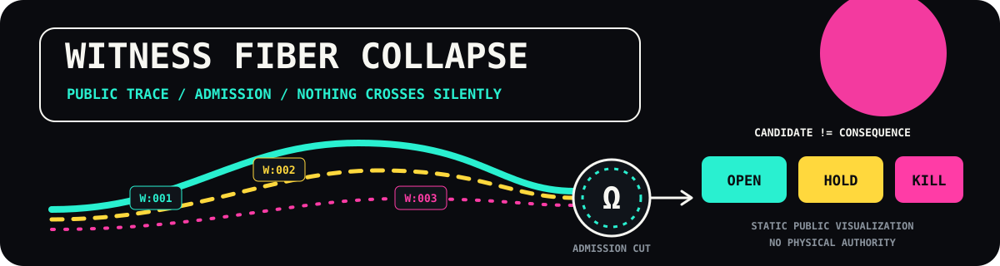

<p align="center">
  
</p>

# `sololys/ky-rox-public-demonstrators` — L2 Consequence Gate Demonstrators (Morandi-Core)

$$\boxed{\text{CANDIDATE\_GENERATION} \neq \text{AUTHORIZATION} \neq \text{REALIZED\_CONSEQUENCE}}$$

$$\Omega(x, e, \Delta_K) = \begin{cases} \text{OPEN} & \text{if } e \neq \varnothing \land \Delta_K(x) \le \tau_K \land \text{Zone}(x) = \text{CLEAR} \\ \text{HOLD} & \text{if } e = \varnothing \lor \text{Zone}(x) = \text{OCCUPIED} \\ \text{KILL} & \text{if } \Delta_K(x) > \tau_K \end{cases}$$

**Compiled Ingress (EN):** Bounded, deterministic `L1` software microtests (`36/36 PASS`) demonstrating fail-closed consequence gating (`OPEN / HOLD / KILL`). Zero external dependencies ($\Sigma_{\text{ext}} = \emptyset$, Python 3.10+ Standard Library only). Zero physical or operational authority (`0.00 V DC`).
**Kompilert Ingress (NO):** Avgrensede, deterministiske `L1`-mikrotester (`36/36 PASS`) for fail-closed konsekvensporter (`OPEN / HOLD / KILL`). Null eksterne avhengigheter ($\Sigma_{\text{ext}} = \emptyset$, kun Python 3.10+ standardbibliotek). Null fysisk eller operasjonell autoritet (`0,00 V DC`).

* **Author:** Marius Egerhei Torjusen ([ORCID: `0009-0006-0431-6637`](https://orcid.org/0009-0006-0431-6637) · [Zenodo DOIs: `10.5281/zenodo.18436983`](https://doi.org/10.5281/zenodo.18436983) · [`10.5281/zenodo.22229111`](https://doi.org/10.5281/zenodo.22229111))

---

## I. Execution Contract (`Makefile` & `run_demo.py`)

```bash
# Default invocation fails closed by design (HOLD = 0.00 V DC):
make
# -> [HOLD] 0.00 V DC. System is at rest. (exit code 1)

# Full deterministic verification of L1_LAW, L2_GATE, Public Surface, and 4 Monoliths (24/24 PASS):
make verify
# Or directly:
python3 run_demo.py
```

---

## II. Subtractive Room Topology

| Room | Role | Primary Artifacts |
| :--- | :--- | :--- |
| **[`L1_LAW/`](L1_LAW/)** | Pure mathematical definitions & public boundary contracts. Zero I/O. | [`invariants_pure.py`](L1_LAW/invariants_pure.py) · [`PUBLIC_BOUNDARY.md`](L1_LAW/PUBLIC_BOUNDARY.md) · [`STATUS_PUBLIC.md`](L1_LAW/STATUS_PUBLIC.md) · [`SECURITY.md`](L1_LAW/SECURITY.md) |
| **[`L2_GATE/`](L2_GATE/)** | Boundary projection & consequence gate evaluator ($\Omega \circ \Pi_K$). | [`evaluate_boundaries.py`](L2_GATE/evaluate_boundaries.py) |
| **[`L3_WITNESS/`](L3_WITNESS/)** | Append-only SHA-256 cryptographic receipts ($W^2$). | [`audit_log.jsonl`](L3_WITNESS/audit_log.jsonl) |
| **[`artifacts/microtests/`](artifacts/microtests/)** | The Six Monoliths (`6 x 6/6 = 36/36 PASS` + `CHECKSUMS.sha256`). | See Section III below |
| **[`punkt/contracts/`](punkt/contracts/)** | Claim-level & decision vocabulary contracts (`INSPIRED_BY != IMPLEMENTS != PROVES`). | [`claim-levels.md`](punkt/contracts/claim-levels.md) · [`candidate-not-consequence.md`](punkt/contracts/candidate-not-consequence.md) · [`decision-vocabulary.md`](punkt/contracts/decision-vocabulary.md) |

---

## III. The Six Monoliths (`36/36 PASS`)

Every demonstrator in [`artifacts/microtests/`](artifacts/microtests/) enforces pinned inputs (`FIXTURE.json`), deterministic stdout matching (`EXPECTED_OUTPUT.txt`), unit tests (`6/6 PASS`), and cryptographic integrity (`CHECKSUMS.sha256`):

| Monolith | Domain & Operator | Mathematical Invariant / Law | Verification |
| :--- | :--- | :--- | :--- |
| **1. [LightBridge v0.1](artifacts/microtests/light_bridge_consequence_gate_v0_1/SURFACE.md)** | Consequence Gate ($\Omega_{\text{bridge}}$) | $\frac{d}{dt}\text{HOLD} = 0$. Realization requires $e \neq \varnothing \land \text{Zone} = \text{CLEAR}$. On `KILL`, collision geometry is severed at $\Delta t = 0$. `reset()` is strictly append-only on witness log $\mathcal{L}$. | [`light_bridge.gd`](artifacts/microtests/light_bridge_consequence_gate_v0_1/light_bridge.gd) · [`light_bridge_gate.py`](artifacts/microtests/light_bridge_consequence_gate_v0_1/light_bridge_gate.py) (**`6/6 PASS`**) |
| **2. [ISAC Phase-Cone v0.1](artifacts/microtests/euclidean_phase_cone_isac_v0_1/SURFACE.md)** | Euclidean Wavefront ($\Pi_{S^1}$) | For $d = \lambda / 2$: $\sin\theta = \Delta\phi / \pi$. Physical wave: $\|\Delta\phi / \pi\| \le 1 \implies \cos\theta \in \mathbb{R} \implies \text{OPEN}$. Synthetic injection: $\|\Delta\phi / \pi\| > 1 \implies \cos\theta \in i\mathbb{R}_{>0} \implies \text{KILL}$. | [`euclidean_phase_cone.py`](artifacts/microtests/euclidean_phase_cone_isac_v0_1/euclidean_phase_cone.py) (**`6/6 PASS`**) |
| **3. [PUNKT // BANE Yin–Yang v0.1](artifacts/microtests/p_np_yinyang_binpacking_v0_1/SURFACE.md)** | Construction Path ($\gamma_P$ vs. $C_{NP}$) | Separates a static certificate point $C \in \mathcal{NP}$ from a sequentially verified construction path $\gamma = (x_0 \to x_n)$ bound by $W_{\text{PRE}}$ and $W_{\text{POST}}$. Status: `p_equals_np_claim_status = HOLD`. | [`yinyang_binpacking.py`](artifacts/microtests/p_np_yinyang_binpacking_v0_1/yinyang_binpacking.py) (**`6/6 PASS`**) |
| **4. [Kernel Drift Observable v0.1](artifacts/microtests/kernel_drift_observable_v0_1/SURFACE.md)** | Relational Geometry ($G_{ij} = \langle \psi_i, \psi_j \rangle$) | Pointwise norm $\|x_t - x_0\|$ is blind to rigid rotations and internal phase shear. Relational drift is measured over the Gram matrix $\Delta_G = \|G(t) - G(0)\|_F$. | [`kernel_drift.py`](artifacts/microtests/kernel_drift_observable_v0_1/kernel_drift.py) (**`6/6 PASS`**) |
| **5. [M-Polynomial & 1-WL Molecular Gate v0.1](artifacts/microtests/mpolynomial_1wl_molecular_gate_v0_1/SURFACE.md)** | Algebraic Graph Gate ($M(G; x, y)$ & $\Pi_K$) | $M(G; x, y) = \sum_{i \le j} m_{ij}x^i y^j$. Soft GNN concatenation ($h_v^{(0)} \parallel M_1 \parallel R \parallel H$) cannot resolve 1-WL co-polynomial collisions (Decalin vs. Bicyclopentyl $\to \text{HOLD}$) or block organic Texas Carbon ($\text{KILL}$), while admitting bio-inorganic `[Fe7MoS9C]` $\mu_6\text{-C}$ ($\text{OPEN}$). | [`mpolynomial_1wl_molecular_gate.py`](artifacts/microtests/mpolynomial_1wl_molecular_gate_v0_1/mpolynomial_1wl_molecular_gate.py) (**`6/6 PASS`**) |
| **6. [PWR2 Scrambling vs. Collective Gate v0.1](artifacts/microtests/pwr2_scrambling_collective_gate_v0_1/SURFACE.md)** | Spectral Spin-Graph Gate ($\Gamma_q^2(K)$ & $k^* \sim \sqrt{N}$) | $\Gamma_q^2(K) = \lambda_K(\lambda_q - \lambda_K)$. At staggered Néel mode $K = N/2$, only `PWR2` has $\lambda_{N/2} > 0$ ($\text{KILL}$ for $k > \sqrt{N}$), while symmetric collective states ($k = 0, \Delta > 0$) pass as $\text{OPEN}$. | [`pwr2_scrambling_collective_gate.py`](artifacts/microtests/pwr2_scrambling_collective_gate_v0_1/pwr2_scrambling_collective_gate.py) (**`6/6 PASS`**) |

---

## IV. Claim & Authority Boundary

```text
PUBLIC_TREE_GATE        = PASS
MICROTEST_GATE          = PASS (6 suites / 36 unit tests)
SCOPE                   = EXACT_CHECKED_TREE_ONLY
CLAIM_STATUS            = HOLD (INSPIRED_BY != IMPLEMENTS != PROVES)
PHYSICAL_AUTHORITY      = NONE (0.00 V DC)
OPERATIONAL_AUTHORITY   = NONE
```

---

<p align="center"><code>GENERATION != AUTHORIZATION != WITNESSED CONSEQUENCE · 0.00 V DC</code></p>

<!-- SOVEREIGN_CONSTELLATION_MAP_START -->
---

## 🧭 Sovereign Architecture Constellation (Cross-Repository Matrix)

This repository is part of a 6-layer deterministic engineering constellation (`L1` software & hardware verification, `INSPIRED_BY != IMPLEMENTS != PROVES`):

| Layer | Repository | Core Engineering Scope | Deterministic Verification |
| :--- | :--- | :--- | :--- |
| **L1 — Law & Monoliths** | [`sololys/ky-rox-public-demonstrators`](https://github.com/sololys/ky-rox-public-demonstrators) | The 7 Public Monoliths: Light Bridge, Euclidean Phase Cone, Point // Trajectory, Kernel Drift, Davisson–Fine–Newton, KY v1.5-MASTER & Staggered-PRF SDR Gate | `42/42 PASS` + `7/7 L1_LAW` |
| **L2 — RTL & Subspace** | [`sololys/epistemic-architectures-notes`](https://github.com/sololys/epistemic-architectures-notes) | COS45 Hankel-SVD Grassmann subspace projection, clocked SystemVerilog RTL (`0.00 V` quench) & Davisson–Fine–Newton Gate | `26/26 PASS` (`PUBLIC_IP_GATE=PASS`) |
| **L3 — Phase & Horizon** | [`sololys/FASE_SPEIL_v0_1`](https://github.com/sololys/FASE_SPEIL_v0_1) | Davisson Bragg coherence ($54\text{ V}/50^\circ$), Fine–Wilf ghost-word detector ($L^* = p+q-\gcd(p,q) = 12$) & Staggered-PRF SDR filter | `26/26 PASS` |
| **L4 — Local-First Net** | [`sololys/Infranett`](https://github.com/sololys/Infranett) | Infranett v0.4: $S_0 = \text{GATE::HOLD}$, Time-of-Flight $d \le 20\text{ m}$, `Noise_KK` 0-RTT & causal persistence (`fsync < RAM < ACK`) | `26/26 PASS` |
| **L5 — Continuous Path** | [`sololys/OrgelKraft`](https://github.com/sololys/OrgelKraft) | Continuous mechanical & acoustic work integration ($\Delta E_k = \int F\,dx$) & multi-period harmonic horizon | `26/26 PASS` |
| **L6 — Cognitive Shield** | [`sololys/TonderSheeld`](https://github.com/sololys/TonderSheeld) | Synthetic psychosomatics, Schaerbeek ceiling ($2^{12}$), Landauer erasure floor ($E_{\min} = k_B T \ln 2$) & Diurnal Gearbox ($S_1$–$S_5$) | `26/26 PASS` |
<!-- SOVEREIGN_CONSTELLATION_MAP_END -->
